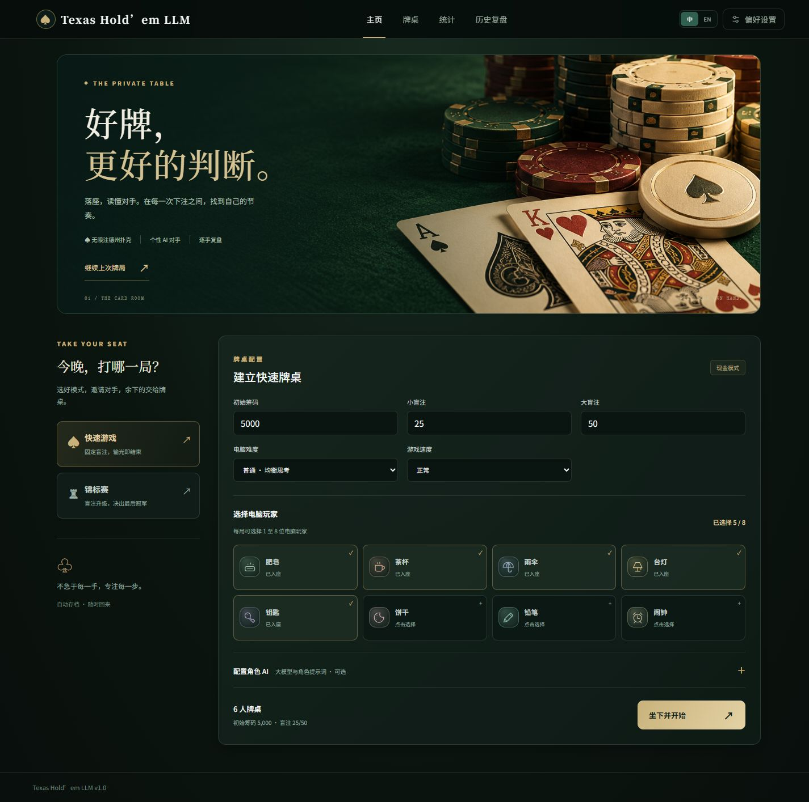
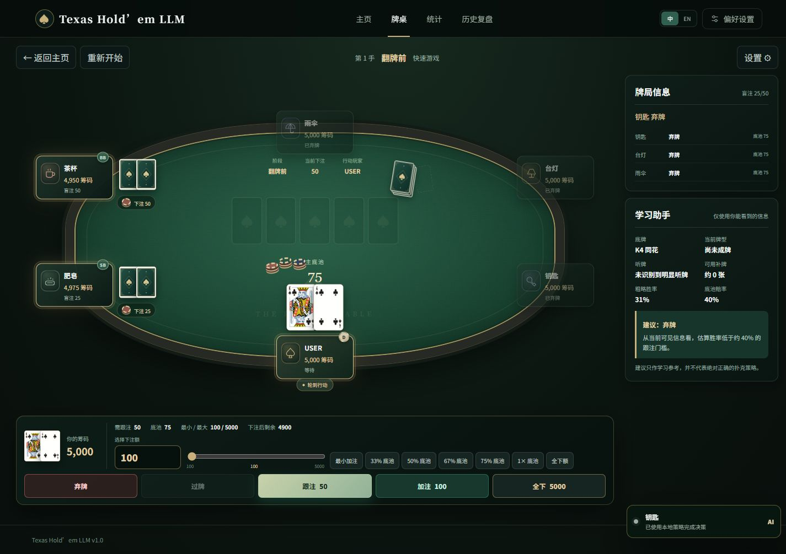

# Texas Hold’em LLM

[English](README.md) | 简体中文

**[在线试玩 → poker.wings030.online](https://poker.wings030.online/)**

一款具有私人牌室风格的单人无限注德州扑克游戏。与 1～8 位电脑对手同桌，打一场快速游戏，或参加单桌锦标赛，再通过统计与回放复盘每一手牌。也可以接入大模型 API，为对手赋予不同的性格、打法和牌桌发言。

打开浏览器即可试玩，也支持在自己的电脑上运行。使用内置策略无需 API Key。所有筹码均为虚拟筹码，不涉及真实货币交易，也不包含多人联网对战。

## 界面预览

墨绿绒面、香槟金细节、定制卡背与八枚角色图标，贯穿大厅和牌桌。布局适配桌面与手机屏幕。

**游戏大厅**



**牌桌对局**



## 功能亮点

- **无限注规则**：支持盲注、最小加注、全下、摊牌、平局分池与多人边池结算。
- **两种游戏模式**：固定盲注的快速游戏，以及盲注逐级上涨、玩家逐步淘汰的单桌锦标赛。
- **自定义牌局**：选择 1～8 位对手，调整初始筹码、盲注、AI 难度与游戏速度。
- **可选大模型对手**：按角色启用模型决策，自定义性格、打法和附加提示词；也可直接使用内置启发式策略。
- **统计与复盘**：记录 VPIP、PFR、WTSD、W$SD、筹码盈亏、连胜连败与起手牌表现，按行动逐步回放；未摊牌的对手底牌保持隐藏。
- **自动存档**：在浏览器中保存当前牌局与最多 300 手牌历史，支持 JSON 导入和导出。
- **中英文界面**：可在页头切换语言，提供响应式布局、动画、音效与可选的新手辅助。

## 在线试玩

1. 打开 **[poker.wings030.online](https://poker.wings030.online/)**。
2. 选择游戏模式、对手和牌桌参数。
3. 想直接使用内置策略，可在“角色 AI”中关闭大模型；想使用模型，则按下方说明配置 API。
4. 开始对局，结束后通过“统计”和“历史复盘”回顾表现。

存档保存在当前浏览器的当前站点中，不会自动跨设备同步。更换浏览器或清理站点数据前，请先导出 JSON 存档。

## 本地运行

安装 **Node.js 22.12 或更高版本**及 npm，然后下载或克隆本仓库。

### Windows

双击 `start.bat`。脚本会安装缺失的依赖、构建项目、启动后端，并打开 [localhost:3000](http://127.0.0.1:3000/)。游玩时保持命令行窗口开启，按 `Ctrl+C` 停止服务。

若 PowerShell 阻止运行 `npm.ps1`，可将下方命令中的 `npm` 换成 `npm.cmd`，或直接使用启动脚本。

### macOS / Linux

```bash
chmod +x start.sh
./start.sh
```

随后打开 [localhost:3000](http://127.0.0.1:3000/)。

### 手动启动

```bash
npm install
npm start
```

`npm start` 会构建前端并启动 Express，通过 [localhost:3000](http://127.0.0.1:3000/) 提供游戏页面。

## 接入大模型

后端支持 OpenAI Chat Completions 协议。填写兼容服务商的 API Base URL、API Key 和模型名称即可接入。

1. 打开“偏好设置 → AI API 设置”。
2. 填写连接信息，例如以 `/v1` 结尾的 API Base URL。
3. 保存配置并测试连接；若无法获取模型列表，可手动填写模型名称。
4. 在“角色 AI”中为各个对手启用大模型，并填写附加提示词。
5. 在“默认提示词”中编辑各角色的性格与打法。

**同一浏览器配置下，各角色共用 API 连接、模型和采样参数。** 角色级设置控制是否使用模型以及角色提示词，不单独选择模型。

模型动作仍需经过规则引擎校验。未配置 API、请求失败或响应不合法时，会回退到合法动作；格式异常的响应也可能经过重试或修复。模型表现和速度取决于服务商。API 调用（包括测试连接）使用你填写的服务商账户，可能产生费用。

## 存档与 API Key

- **牌局数据**：设置、统计、历史和当前牌局保存在浏览器 `localStorage` 中。JSON 导出包含游戏数据，不包含 API Key 或 API 访问凭据。
- **访客配置**：浏览器保存随机访问凭据，后端据此隔离 API 配置、日志与请求取消权限。同一浏览器中，同一站点的标签页共用配置；其他浏览器或站点来源使用独立存储。
- **密钥存储**：服务商请求由本站后端转发，API Key 保存在运行该后端的服务器上，服务器管理员具有文件访问权限。使用在线试玩时，密钥保存在站点服务器；自行部署时，保存在自己的服务器。已保存的完整密钥不会返回页面，未配置时也不会使用站长的 Key。
- **删除密钥**：请先在“AI API 设置”中点击“清除配置”，再清理浏览器站点数据。仅清理浏览器数据会删除访问凭据，但不会删除服务器上的配置文件。

运行时配置与日志已排除在 Git 跟踪之外，日志会对常见凭据字段脱敏。相关实现和测试见 [server/](server/)。

## 本地开发

项目使用 **React、TypeScript、Vite、Express 和 Vitest**。执行 `npm install` 后，在两个终端分别启动后端和前端：

```bash
# Terminal 1
npm run server

# Terminal 2
npm run dev
```

打开 [localhost:5173](http://127.0.0.1:5173/)。Vite 会将 `/api` 请求代理到 3000 端口的后端。

| 命令 | 用途 |
| --- | --- |
| `npm start` | 构建并启动应用 |
| `npm run dev` | 启动 Vite 开发服务器 |
| `npm run server` | 启动 Express 后端 |
| `npm run build` | 执行 TypeScript 检查并构建生产版本 |
| `npm test` | 运行 Vitest 测试 |
| `npm run test:watch` | 以监听模式运行测试 |
| `npm run mock-provider` | 启动本地模拟 LLM 服务 |

### 无需 API 额度的测试

启动本地应用后，另开一个终端运行 `npm run mock-provider`，然后填写：

```text
API Base URL: http://127.0.0.1:3999/v1
API Key: mock-key
Model: mock-normal
```

模拟服务还提供流式响应、鉴权失败、限流、超时、断流、格式错误和非法动作等场景。模型名称见 [server/mockProvider.js](server/mockProvider.js)。请搭配本地后端使用；在线试玩的服务器无法通过此回环地址访问你电脑上的模拟服务。

### 项目结构

```text
public/art/       大厅主视觉
public/cards/     牌面与定制卡背
src/components/   牌桌、操作区、设置与公共组件
src/engine/       发牌、下注、牌型、奖池、赔率与锦标赛
src/pages/        大厅、对局、统计与复盘
src/storage/      浏览器存档、导入导出与统计
server/           Express API、模型请求、日志与测试
shared/           前后端共享的角色定义
docs/             美术说明与界面截图
```

### 自行部署

执行 `npm install` 和 `npm start`。Express 在 `127.0.0.1:3000` 提供 `dist/` 静态文件与 API，可通过 `PORT` 修改端口。公网访问需在前方配置 HTTPS 反向代理，并保留 AI 接口的流式响应。完整的大模型功能依赖后端，不能仅使用纯静态托管。

访客配置默认保存在 `config/visitors/`，日志保存在 `logs/visitors/`。可通过 `AI_CONFIG_DIR` 和 `AI_LOG_DIR` 修改配置根目录与日志根目录。旧版 `config/api-config.json` 不用于访客请求，请在页面中重新配置 API。

## 开源协议与美术

项目采用 [MIT License](LICENSE)。视觉资源、大厅主视觉的生成提示词与验证记录见[美术说明](docs/ART_DIRECTION.md)。
